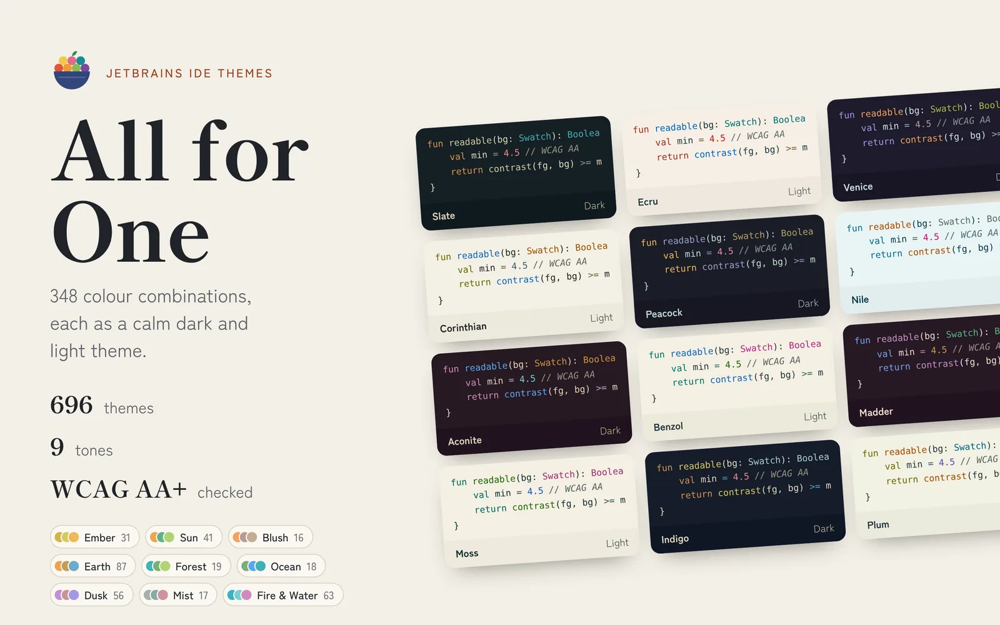
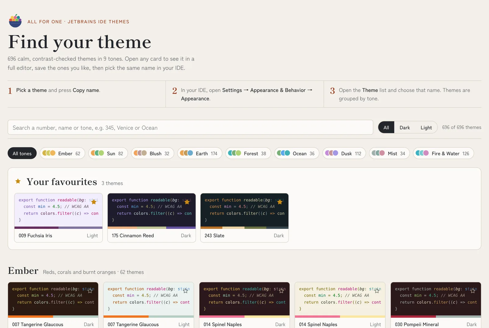
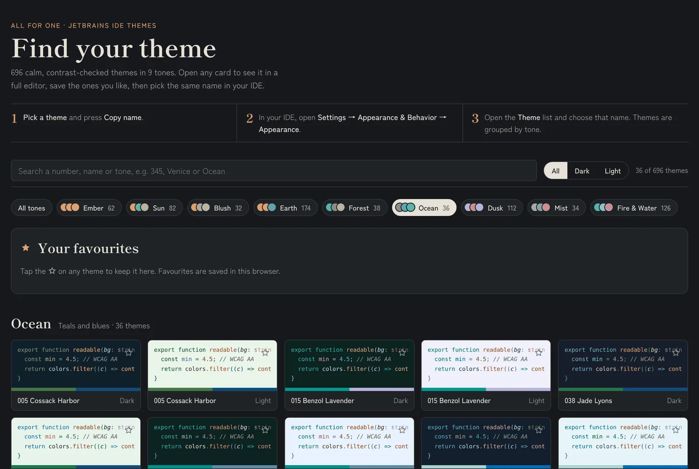
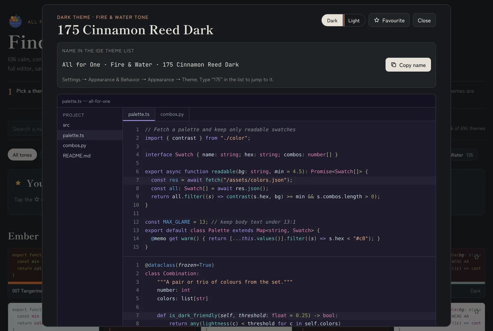
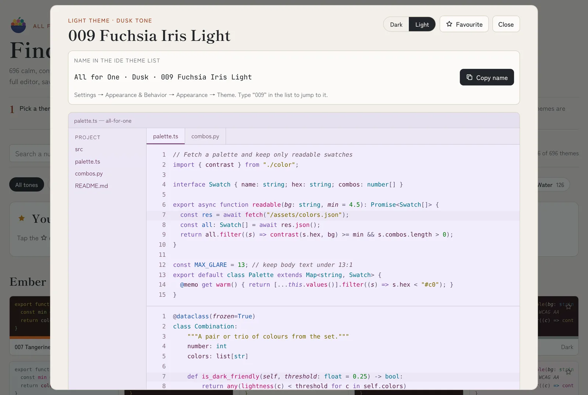
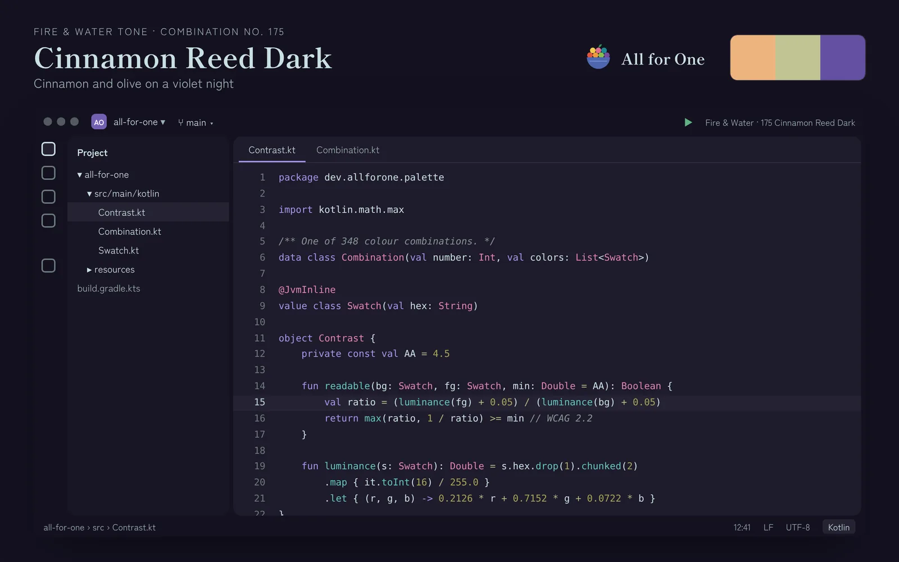
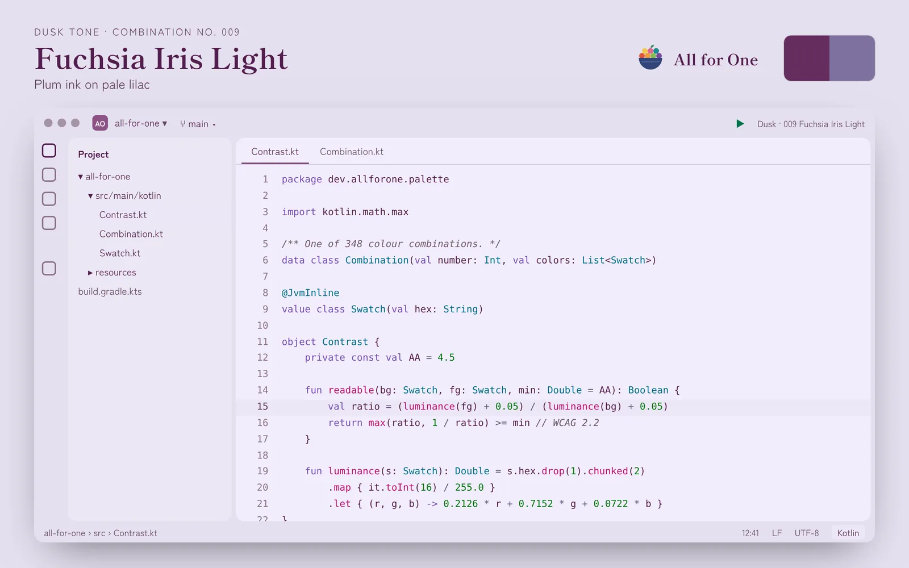

  

<h1 align="center">All for One</h1>

  <b>696 calm, contrast-checked themes for JetBrains IDEs, in one plugin.</b> 
  348 colour combinations, each as a dark and a light theme, grouped into 9 tones.

  <a href="https://weamadel.github.io/all-for-one-themes/"><b>Browse all themes →</b></a>

## Find your theme

The [theme gallery](https://weamadel.github.io/all-for-one-themes/) shows every theme as a small code card. Filter by tone or by dark and light, or search by number, name or tone.

Tap the star on any theme to keep it in **Your favourites** at the top. Favourites are saved in your browser.

## Preview it in a full editor

Open any card to see the theme in a full editor window with TypeScript and Python. Switch between its dark and light version, then press **Copy name** to get the exact name shown in the IDE.

| Dark | Light |
| --- | --- |
|  |  |

## In the IDE

Each theme styles the whole IDE, not just the editor: tool windows, tabs, popups, icons, checkboxes, the console and the terminal. It is built on JetBrains' Islands look.

## Install

1. Install **All for One** from the JetBrains Marketplace (coming soon): in your IDE, open **Settings → Plugins → Marketplace** and search for "All for One".
2. Open **Settings → Appearance & Behavior → Appearance**.
3. Open the **Theme** list and pick a theme. Every name starts with "All for One", then the tone and the theme's number, for example `All for One · Fire & Water · 175 Cinnamon Reed Dark`. Type the number to jump to it.

## Made to be easy on the eyes

- Body text sits between 11:1 and 14:1 contrast: easy to read, without the glare of pure white on black.
- Every syntax colour and comment reaches at least 4.5:1 (WCAG AA) on the editor background.
- The open file's tab, selected rows and selected code are always clearly visible, and text stays readable on them.
- Every build is checked automatically against more than 2.2 million colour rules, so no JetBrains default colour is left behind.

## The 9 tones

| Tone | Colours | Themes |
| --- | --- | ---: |
| Ember | Reds, corals and burnt oranges | 62 |
| Sun | Golds, yellows and warm ochres | 82 |
| Blush | Soft pinks, peach and salmon | 32 |
| Earth | Browns, olives and muted warm tones | 174 |
| Forest | Greens and yellow-greens | 38 |
| Ocean | Teals and blues | 36 |
| Dusk | Violets, purples and pinks | 112 |
| Mist | Soft greys and pale, quiet colours | 34 |
| Fire & Water | Warm and cool colours in equal contrast | 126 |

## About this repository

This repository hosts the theme gallery at [weamadel.github.io/all-for-one-themes](https://weamadel.github.io/all-for-one-themes/). It is a static page: `index.html` and the theme list in `themes.json`. No build step is needed.
